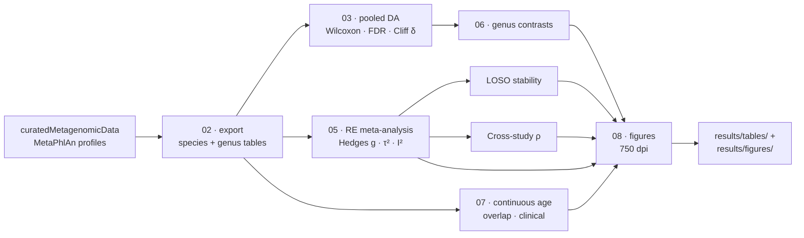
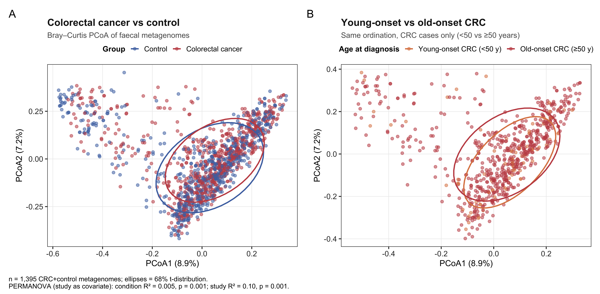
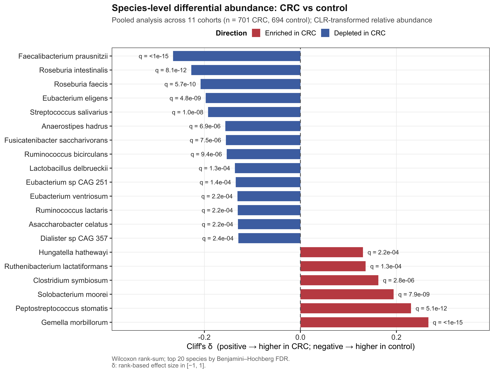
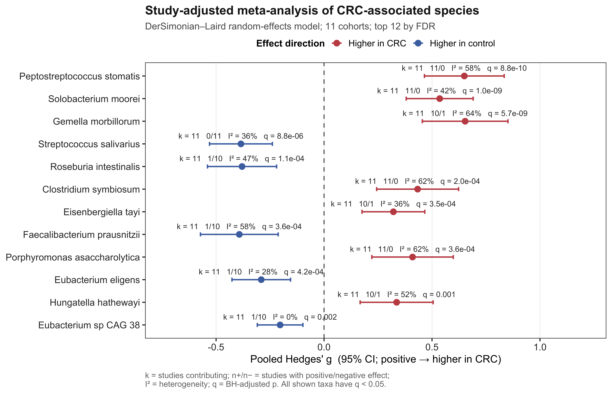
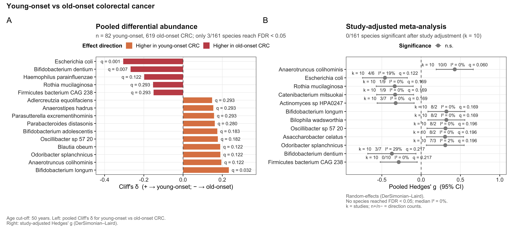
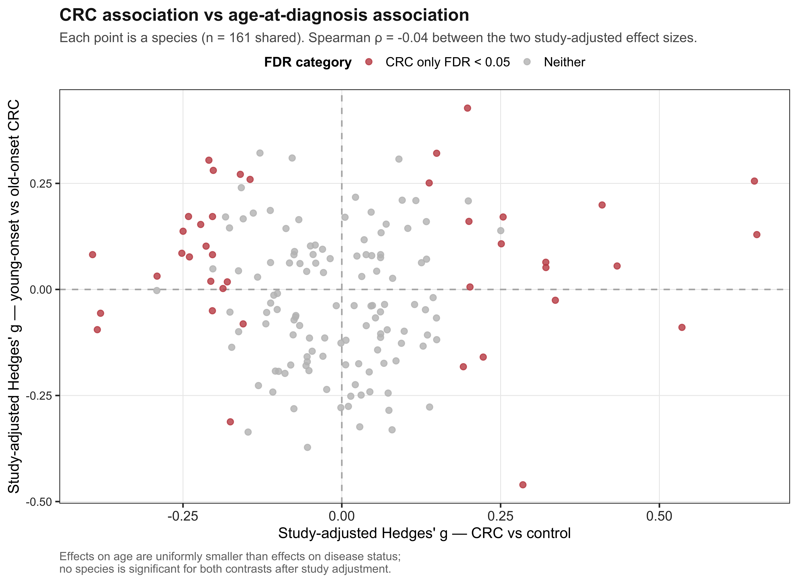
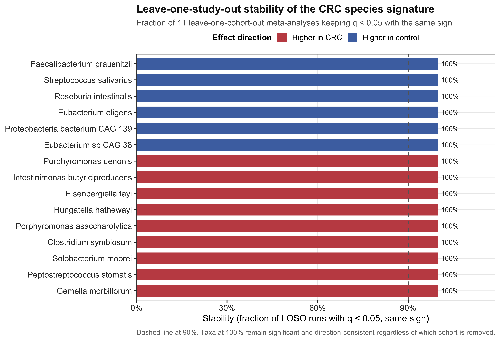
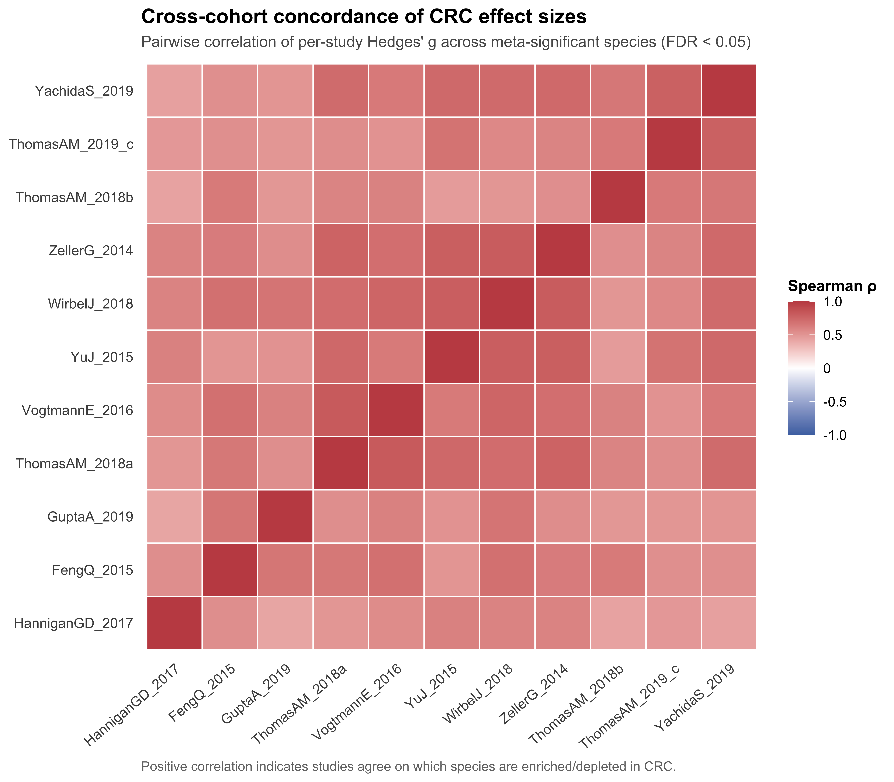
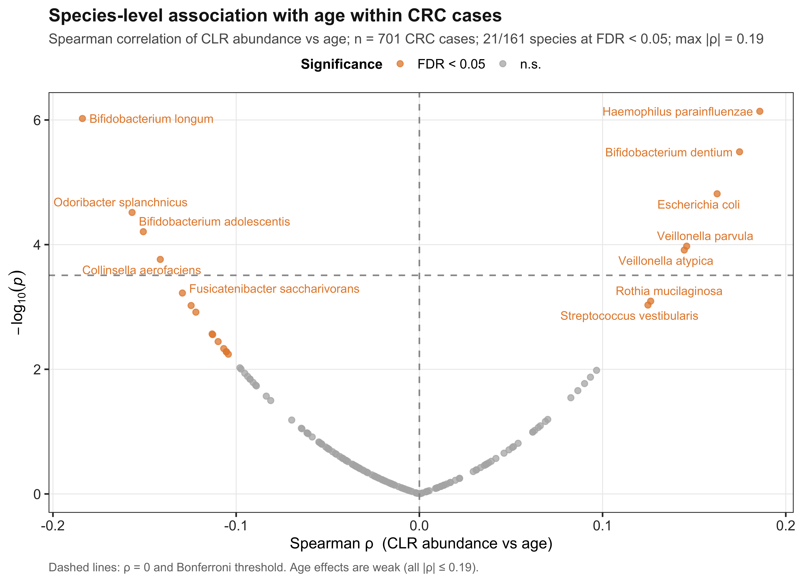
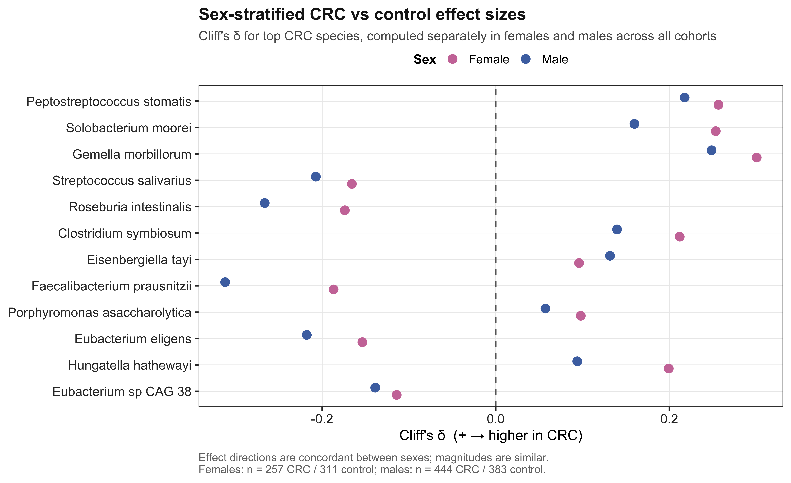

<div align="center">

# crcmeta

### Study-adjusted meta-analysis of multicohort shotgun metagenomes

[](LICENSE)
[](https://www.r-project.org/)
[](https://bioconductor.org/packages/curatedMetagenomicData)
[](https://github.com/ejtettevi/crcmeta/releases)
[](https://doi.org/10.5281/zenodo.pending)
[](https://style.tidyverse.org/)

**Reproducible R workflow** for pooling faecal shotgun metagenomes across studies without treating batch effects as biology — demonstrated on 11 public colorectal cancer (CRC) cohorts.

[Getting started](#-getting-started) · [Pipeline](#-pipeline) · [Key results](#-key-results) · [Figures](#-figure-gallery) · [Cite](#-citation)

</div>

---

## Why crcmeta?

Pooling samples across studies is the default move when individual cohorts are small — and the fastest way to turn study identity into a false biological signal.

`crcmeta` is a fully scripted pipeline that instead:

| Step | What it does |
|:----:|--------------|
| **1** | Exports species / genus MetaPhlAn profiles from [*curatedMetagenomicData*](https://bioconductor.org/packages/curatedMetagenomicData) |
| **2** | CLR-transforms abundances **within each study** |
| **3** | Runs pooled differential abundance (Wilcoxon · BH-FDR · Cliff’s δ) |
| **4** | Combines within-study Hedges’ *g* via **DerSimonian–Laird random-effects** meta-analysis |
| **5** | Reports **leave-one-study-out (LOSO)** stability + **cross-study effect concordance** |
| **6** | Regenerates all manuscript figures at **750 dpi** from one script |

> [!TIP]
> The same pipeline recovers a large, LOSO-stable CRC disease signature **and** a correctly null young- vs old-onset age contrast — evidence that study adjustment does not manufacture significance.

---

## Pipeline overview



---

## Key results

Validation case study on **11 public CRC shotgun cohorts** (1,650 faecal metagenomes · 701 CRC · 694 controls · 209 adenomas), all from *curatedMetagenomicData*.

<div align="center">

| | Disease signature (CRC vs control) | Age-at-diagnosis (young vs old CRC) |
|:-:|:--|:--|
| Study-adjusted taxa (FDR &lt; 0.05) | **40 / 161** | **0 / 161** |
| LOSO stability (top 20) | **100 %** in all 11 refits | — |
| Median cross-study effect ρ | **0.61** (range 0.42–0.82) | — |
| Leading effect size | *P. stomatis* g = **+0.65** (11/11 enriched) | max \|ρ\| age = **0.19** |

</div>

> [!IMPORTANT]
> **Take-home:** young-onset CRC is not a distinct microbial entity at species resolution once study is modelled as a random effect. Biomarker work for early-onset disease should not assume a separate age-specific microbiome.

<details>
<summary><b>Full numerical summary</b> (click to expand)</summary>

| Comparison | n (group A) | n (group B) | Significant taxa (q &lt; 0.05) |
|------------|------------:|------------:|------------------------------:|
| CRC vs control (pooled) | 701 | 694 | 88 / 161 |
| CRC vs control (study-adjusted) | — | — | **40 / 161** |
| Adenoma vs control (study-adjusted) | 209 | — | **0 / 161** |
| Young (&lt;50) vs old (≥50) CRC (study-adjusted) | 82 | 619 | **0 / 161** |
| Species vs age within CRC (Spearman) | 701 | — | 21 / 161 (max \|ρ\| = 0.19) |

See [`results/RESULTS_SUMMARY.md`](results/RESULTS_SUMMARY.md) and [`results/tables/`](results/tables/).

</details>

---

## Figure gallery

All figures are generated by [`analysis/08_figures_publication.R`](analysis/08_figures_publication.R) at 750 dpi from the same TSVs that back the tables.

<table>
<tr>
<td width="50%" align="center">
<br/>
<sub><b>Fig 1</b> · Community ordination · study ≫ condition</sub>
</td>
<td width="50%" align="center">
<br/>
<sub><b>Fig 2</b> · Pooled CRC effect sizes (Cliff’s δ)</sub>
</td>
</tr>
<tr>
<td width="50%" align="center">
<br/>
<sub><b>Fig 3</b> · Forest plot · random-effects g</sub>
</td>
<td width="50%" align="center">
<br/>
<sub><b>Fig 4</b> · Young vs old-onset · null after adjustment</sub>
</td>
</tr>
<tr>
<td width="50%" align="center">
<br/>
<sub><b>Fig 5</b> · Disease vs age effects · ρ = −0.04</sub>
</td>
<td width="50%" align="center">
<br/>
<sub><b>Fig 6</b> · LOSO stability · top 20 = 100 %</sub>
</td>
</tr>
<tr>
<td width="50%" align="center">
<br/>
<sub><b>Fig 7</b> · Cross-cohort concordance · median ρ = 0.61</sub>
</td>
<td width="50%" align="center">
<br/>
<sub><b>Fig 8</b> · Continuous age within CRC · weak effects</sub>
</td>
</tr>
<tr>
<td colspan="2" align="center">
<br/>
<sub><b>Fig 9</b> · Sex-stratified CRC signature · direction-concordant</sub>
</td>
</tr>
</table>

---

## Getting started

### Prerequisites

| Requirement | Version / notes |
|-------------|-----------------|
| R | ≥ 4.0 |
| Bioconductor | ≥ 3.14 with **curatedMetagenomicData** |
| CRAN packages | `ggplot2`, `patchwork`, `vegan`, `readr`, `dplyr`, `tidyr`, `forcats`, `scales` |
| Hardware | ~4 GB RAM · ~2 GB disk after profile export |

```r
if (!requireNamespace("BiocManager", quietly = TRUE))
    install.packages("BiocManager")
BiocManager::install("curatedMetagenomicData")
install.packages(c("ggplot2", "patchwork", "vegan", "readr",
                   "dplyr", "tidyr", "forcats", "scales"))
```

### Install

```bash
git clone https://github.com/ejtettevi/crcmeta.git
cd crcmeta
```

### Run the full pipeline

From the repository root:

```bash
bash  analysis/01_fetch_metadata.sh           # optional · cache ENA/SRA reports
Rscript analysis/02_fetch_profiles.R          # export MetaPhlAn profiles + metadata
Rscript analysis/03_differential_abundance.R  # pooled Wilcoxon + Cliff's delta
Rscript analysis/05_meta_analysis.R           # RE meta-analysis + LOSO + cross-study ρ
Rscript analysis/06_genus_level.R             # genus-level contrasts
Rscript analysis/07_extended_analyses.R       # continuous age · overlap · clinical
Rscript analysis/08_figures_publication.R     # all nine figures at 750 dpi
```

Outputs appear in [`results/tables/`](results/tables/) and [`results/figures/`](results/figures/).

<details>
<summary><b>Customise the cohort set</b></summary>

Edit [`config/cohorts.tsv`](config/cohorts.tsv) to change which *curatedMetagenomicData* study IDs are included. Defaults match the 11-cohort CRC analysis (`FengQ_2015` … `ZellerG_2014`).

</details>

---

## Project layout

```text
crcmeta/
├── analysis/          # pipeline scripts 00–08 (run in order)
├── config/            # cohort list + environment snapshot
├── results/
│   ├── tables/        # all derived TSV/CSV outputs
│   ├── figures/       # fig1–fig9 · 750 dpi PNG
│   └── RESULTS_SUMMARY.md
├── data/              # profile cache · regenerate with script 02 (not committed)
├── logs/              # run logs (not committed)
└── manuscript/        # submission materials · not part of this release
```

---

## Validation at a glance

| Check | Expectation | Observed |
|-------|-------------|----------|
| Strong positive control (CRC vs control) | Large, direction-consistent effect | 40 study-adjusted species · top-20 LOSO = 100 % |
| Correct null (young vs old-onset) | No consistent age signal after adjustment | 0 / 161 study-adjusted species |
| Cross-cohort agreement | Positive pairwise effect ρ | median ρ = 0.61 · all pairs positive |
| Study vs condition variance | Study dominates residual community structure | study R² = 0.101 · condition R² = 0.005 |

---

## Citation

When using this workflow, please cite:

1. **This software** (DOI assigned on Zenodo archival — release tag `vX.Y.Z`)
2. **curatedMetagenomicData** and the original cohort studies listed in [`results/tables/study_characteristics.tsv`](results/tables/study_characteristics.tsv)

```bibtex
@software{crcmeta,
  author  = {Tetteh, E. and co-authors},
  title   = {crcmeta: study-adjusted meta-analysis of multicohort shotgun metagenomes},
  year    = {2026},
  url     = {https://github.com/ejtettevi/crcmeta},
  license = {MIT}
}
```

A machine-readable [`CITATION.cff`](CITATION.cff) is included in the repository root.

---

## License

MIT © [ejtettevi](https://github.com/ejtettevi) — see [`LICENSE`](LICENSE).

---

## Acknowledgements

Profiles and curated metadata are distributed by the [*curatedMetagenomicData*](https://bioconductor.org/packages/curatedMetagenomicData) project (Waldron Lab). Underlying primary data belong to the original cohort investigators.

---

<div align="center">
<sub>Built for reproducible multi-cohort microbiome meta-analysis · <a href="https://github.com/ejtettevi/crcmeta">github.com/ejtettevi/crcmeta</a></sub>
</div>
